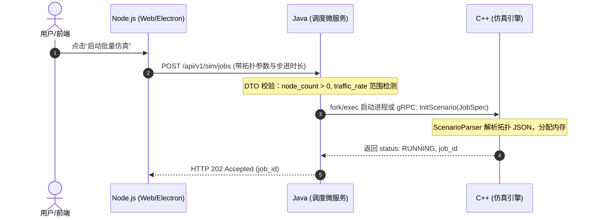

拿到 `ast-grep` 和 `Code-Graph-RAG` 生成的拓扑图谱 JSON 后，若只把它当作静态文档用 `understand-anything` 随意翻看，它就只是一个“可视化看图工具”。

要将其转化为**业务链时序**、**接口契约文档**和**自动化测试用例（你提到的测试网格/用例工程）**，核心在于建立一条“图路径查询（Graph Query） $\to$ Prompt 上下文组装 $\to$ 结构化输出校验”的自动化工程管道。

---

### 一、 核心逻辑：从图数据到测试资产的处理流水线

```
┌────────────────────────────────────────────────────────┐
│     Code-Graph-RAG 导出的拓扑 JSON (Nodes & Edges)     │
└───────────────────────────┬────────────────────────────┘
                            │
                            ▼ 
┌────────────────────────────────────────────────────────┐
│  步骤 1：图路径寻径器 (Graph Path Extractor - Python)   │
│  - 过滤 EntryPoints (Node.js API / Java Controller)    │
│  - 深度/广度优先搜索沿 Edges 寻径至 C++ Engine          │
│  - 提取完整单条路径子图 (Sub-Graph Path)                │
└───────────────────────────┬────────────────────────────┘
                            │
                            ▼ 
┌────────────────────────────────────────────────────────┐
│  步骤 2：切片注入 LLM Agent / understand-anything 引擎   │
│  - Prompt 注入：路径调用栈 + DTO/结构体源码片段         │
└──────┬────────────────────┼────────────────────┬───────┘
       │                    │                    │
       ▼ (模式 A)           ▼ (模式 B)           ▼ (模式 C)
┌──────────────┐     ┌──────────────┐     ┌──────────────┐
│  业务时序链  │     │ OpenAPI契约  │     │ 自动化测试用例│
│ (Mermaid)    │     │ 文档 (YAML)  │     │ (pytest脚本) │
└──────────────┘     └──────────────┘     └──────────────┘

```

---

### 二、 步骤拆解与落地实现

#### 第一步：用脚本把全局图切片为“单条业务链路”（图寻径）

不要把整个几兆的全局图 JSON 一股脑直接丢给 LLM，大模型会丢失重点。写一个几十行的 Python 脚本，以**前端入口或 Java Controller** 为起点，沿着引用关系找到**底层 C++ 执行函数**，提取出线性/树状子图。

```python
# extract_subgraph.py 示例逻辑
import json

with open("code_graph.json") as f:
    graph = json.load(f)

def trace_execution_path(start_node_id, visited=None):
    if visited is None:
        visited = []
    visited.append(start_node_id)
    
    # 查找该节点发起的下游调用 (CALLS, TRIGGERS_API, DISPATCHES_CMD)
    outgoing_edges = [
        e for e in graph["edges"] 
        if e["source"] == start_node_id and e["type"] in ["TRIGGERS_API", "CALLS", "IPC_INVOKE"]
    ]
    
    paths = []
    if not outgoing_edges:
        return [visited]
    for edge in outgoing_edges:
        next_node = edge["target"]
        if next_node not in visited:
            paths.extend(trace_execution_path(next_node, list(visited)))
    return paths

# 示例：以 Java 的 CreateSimulationController 为起点寻径到 C++ Simulator::step
chains = trace_execution_path("java::com.sim.controller.SimTaskController.createTask")

```

---

#### 第二步：通过 Agent / understand-anything 自动化生成三种资产

拿到切片出来的路径节点列表（Node.js 请求 $\to$ Java Controller $\to$ DTO 校验 $\to$ C++ 引擎参数加载）后，将其与源码片段组装成 Prompt，交给 LLM 批量生产：

### 1. 提取端到端业务链（输出：Mermaid 时序图）

**Prompt 模板设计：**

> “以下是跨三端的代码调用链路上下文：
> * 包含前端请求：`{frontend_code_snippet}`
> * 调度服务端点：`{backend_controller_snippet}`
> * 底层引擎响应函数：`{cpp_engine_snippet}`
> 
> 
> 请梳理完整的业务流向、各端数据转换规则与异步等待机制，输出标准 Mermaid Sequence Diagram 及业务链路逻辑解释。”

**输出产物（自动生成）：**



---

### 2. 自动化生成接口契约文档（输出：OpenAPI 3.0 / Swagger）

在图数据中，Java 端的入参对象（如 `SimRequestDTO`）和 C++ 端的解析结构体包含了所有字段约束。让模型依据这套 AST 信息合成规范文档。

**Prompt 模板设计：**

> “根据当前调用链上下文中的 Java Controller 路由、参数校验注解（如 `@NotNull`, `@Min(1)`）以及 C++ 结构体中字段提取逻辑，生成符合 OpenAPI 3.0 规范的 YAML 格式文档。务必补全字段类型、默认值、边界限制及 200/400/500 状态码响应结构。”

**输出产物（直接导入 Swagger UI / Apifox）：**

```yaml
openapi: 3.0.0
info:
  title: 仿真调度接口
  version: 1.0.0
paths:
  /api/v1/sim/jobs:
    post:
      summary: 创建并调度仿真任务
      requestBody:
        required: true
        content:
          application/json:
            schema:
              type: object
              required: [topology_type, node_count]
              properties:
                topology_type:
                  type: string
                  enum: [mesh, star, ring]
                node_count:
                  type: integer
                  minimum: 2
                  maximum: 1000

```

---

### 3. 自动化生成自动化测试用例（输出：Python + pytest 脚本）

有契约与调用链后，便可让 AI 按照“**正向业务流、字段边界值越界、引擎报错回传**”三个维度批量生成自动化测试工程代码。

**Prompt 模板设计：**

> “作为资深测试开发专家，基于此接口契约与后端处理逻辑，生成一组 `pytest` 自动化测试用例。要求包含：
> 1. 标准正常业务流程调用。
> 2. 参数边界校验（超出 C++ 引擎负荷或不合法的参数组合）。
> 3. 轮询并断言最终生成的仿真指标结构。请使用 `requests` 库实现。”
> 
> 

**输出产物（直接并入测试工程仓库）：**

```python
# test_sim_scheduler_pipeline.py
import pytest
import requests
import time

BASE_URL = "http://localhost:8080/api/v1"

class TestSimulationPipeline:
    
    @pytest.mark.parametrize("node_count,expected_status", [
        (10, 202),       # 正常流
        (1, 400),        # 边界值异常：node_count 必须 >= 2
        (2000, 400)      # 边界值异常：超限拦截
    ])
    def test_create_and_schedule_job(self, node_count, expected_status):
        payload = {
            "topology_type": "mesh",
            "node_count": node_count,
            "duration_sec": 60
        }
        res = requests.post(f"{BASE_URL}/sim/jobs", json=payload)
        assert res.status_code == expected_status
        
        if expected_status == 202:
            job_id = res.json().get("job_id")
            # 轮询状态直到 C++ 仿真引擎计算完毕
            for _ in range(10):
                status_res = requests.get(f"{BASE_URL}/sim/jobs/{job_id}")
                if status_res.json().get("state") == "COMPLETED":
                    break
                time.sleep(1)
            
            # 断言输出指标字段完整度
            metrics = status_res.json().get("metrics", {})
            assert "throughput_mbps" in metrics
            assert "packet_loss_rate" in metrics

```

---

### 三、 测试团队落地的三阶段路线

1. **写寻径脚本（半天）**：写个小 Python 脚本，以 JSON 为输入，给定一个 URL 路由名称，沿着图的边提取出 `[前端文件 -> Java文件 -> C++文件]` 的最小链路集合。
2. **固化 Prompt 为 CLI 工具（1-2 天）**：将上述三种场景的 Prompt 封装成测试团队内部脚本，如：
* `sim-test-cli gen-docs --route /api/v1/sim/jobs`
* `sim-test-cli gen-cases --route /api/v1/sim/jobs`


3. **CI 联动生成**：当开发提交代码更新时，CI 自动触发提取改动链路，重新生成变更接口的用例与文档，实现“代码更新，用例与文档自动同步”。